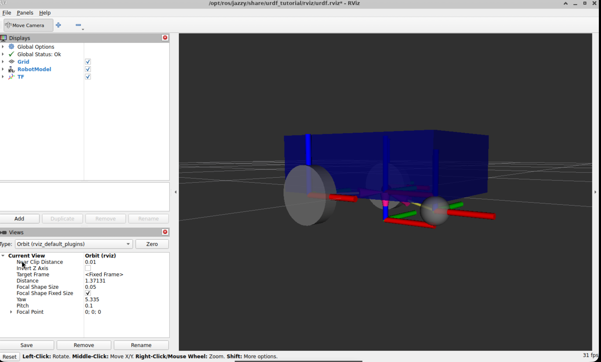

My first robot model using ROS 2 Jazzy and URDF.
# First URDF Robot

A simple two-wheeled robot model created while learning robot description and visualization with ROS 2 Jazzy.

## Overview

This project introduces the fundamentals of building a robot model in URDF, including links, joints, geometry, coordinate frames, and wheel placement.

## Robot Model

- Rectangular chassis: **0.60 × 0.40 × 0.20 m**
- Two cylindrical wheels: **0.10 m radius**, **0.05 m thickness**
- Continuous joints connecting each wheel to the chassis
- Robot visualization using **RViz2**

## Preview



## Requirements

- ROS 2 Jazzy
- `urdf_tutorial` package
- RViz2

## View in RViz2

From a terminal with ROS 2 sourced, run:

```bash
ros2 launch urdf_tutorial display.launch.py model:=/path/to/my_robot.urdf
```

Replace `/path/to/my_robot.urdf` with the absolute path to the URDF file.

## Files

```text
01-first-robot/
├── README.md
├── my_robot.urdf
└── images/
    └── robot_rviz.png
```

## What I Learned

- Defining robot components with URDF links
- Connecting components using joints
- Positioning geometry with `origin xyz` and `rpy`
- Setting joint rotation axes
- Visualizing a robot model in RViz2

## Current Status

This is an introductory **visualization model**, not yet a complete physics-based simulation. Gazebo integration, collision geometry, inertial properties, and robot control may be added in future projects.

## License

This project is part of the [ROS 2 Robot Projects](../) repository and is covered by its [MIT License](../LICENSE).
