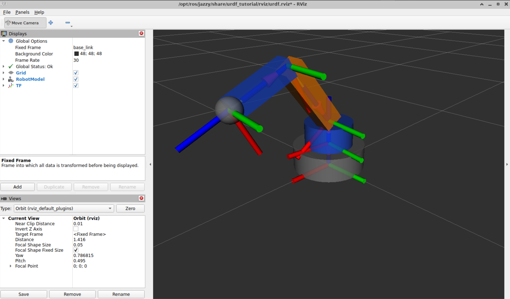

3-DOF Robotic Arm — ROS 2

A simple 3-degree-of-freedom (3-DOF) robotic arm modeled using URDF (Unified Robot Description Format) and visualized in RViz2.

The robot consists of a fixed base, a rotating platform, an upper arm, a forearm, and a simple end-effector placeholder.

This project demonstrates the use of URDF links, joints, coordinate frames, and joint limits in ROS 2.

Robot Preview

Features

* 3 degrees of freedom (3-DOF)
* Base rotation: 180° total range (−90° to +90°)
* Shoulder rotation: −90° to +90°
* Elbow rotation: −135° to +135°
* URDF model using basic geometric shapes
* Joint limits defined using revolute joints
* Interactive joint visualization in RViz2

Robot Structure

The robotic arm contains the following main components:

Component	Description
base_footprint	Ground reference frame
base_link	Fixed base
rotating_base_link	Rotating platform
upper_arm_link	First arm segment (30 cm)
forearm_link	Second arm segment (25 cm)
tool_link	End-effector placeholder

Joints

Joint	Type	Rotation Axis	Limits
base_rotation_joint	Revolute	Z	−90° to +90°
shoulder_joint	Revolute	Y	−90° to +90°
elbow_joint	Revolute	Y	−135° to +135°

Requirements

* ROS 2 Jazzy
* RViz2
* urdf_tutorial
* joint_state_publisher_gui

Running the Robot in RViz2

Launch the URDF model using:

ros2 launch urdf_tutorial display.launch.py model:=/path/to/my_robotic_arm.urdf

Replace /path/to/my_robotic_arm.urdf with the actual path to the URDF file.

The Joint State Publisher GUI allows interactive control of the three revolute joints.

Project Structure

02-3dof-robotic-arm/
├── my_robotic_arm.urdf
├── README.md
└── images/
    └── robotic_arm_rviz.png

Notes

This project focuses on URDF modeling and visualization in RViz2.

The current model does not include collision geometry, inertial properties, or simulation controllers required for physics-based simulation in Gazebo.
